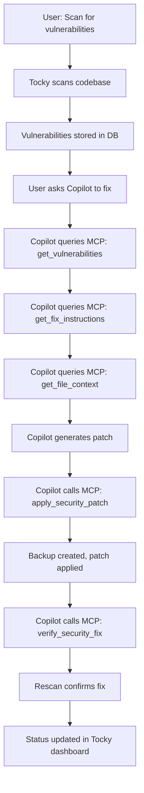

# Tocky Code - MCP Integration Setup Guide

## What is MCP?

**Model Context Protocol (MCP)** is a standardized way for AI assistants like GitHub Copilot to interact with external tools and data sources. Think of it as an API that lets Copilot access your vulnerability scanner's findings and automatically generate fixes.

## Why Use MCP Instead of the VS Code Language Model API?

| Feature | MCP Integration | VS Code LM API |
|---------|----------------|----------------|
| **Copilot Access to Data** | ✅ Direct access to vulnerability database | ❌ No access, needs manual copy/paste |
| **Automated Workflows** | ✅ Multi-step fix automation | ❌ Manual step-by-step |
| **Context Aware** | ✅ Copilot sees all findings | ❌ One finding at a time |
| **Batch Operations** | ✅ Fix multiple vulnerabilities | ❌ One at a time |
| **Verification** | ✅ Automated re-scan | ❌ Manual verification |

## Quick Start

### Step 1: Install MCP Dependencies

```bash
cd E:\Miniproject\backend
pip install mcp pydantic
```

### Step 2: Configure GitHub Copilot

The configuration file `.vscode/mcp.json` has already been created for you:

```json
{
  "mcpServers": {
    "tocky-code": {
      "command": "python",
      "args": ["backend/mcp_server/server.py"],
      "env": {
        "TOCKY_WORKSPACE": "${workspaceFolder}"
      }
    }
  }
}
```

### Step 3: Reload VS Code

```
Ctrl+Shift+P → "Developer: Reload Window"
```

### Step 4: Verify MCP Server

Open Copilot Chat and ask:
```
@workspace What security vulnerabilities do you see?
```

Copilot should now be able to query Tocky's vulnerability database!

## How to Use

### Example 1: Get Vulnerability Report

In Copilot Chat:
```
@workspace Show me all critical security vulnerabilities
```

Copilot will call the `get_vulnerabilities` MCP tool and display results.

### Example 2: Fix a Specific Vulnerability

```
@workspace Fix vulnerability VULN-001 with SQL injection in database.py
```

Copilot will:
1. Call `get_fix_instructions` to understand the issue
2. Call `get_file_context` to see the code
3. Generate a secure fix
4. Call `apply_security_patch` to apply it
5. Call `verify_security_fix` to confirm

### Example 3: Batch Fix All SQL Injections

```
@workspace Find all SQL injection vulnerabilities and fix them one by one
```

### Example 4: Scan and Fix

```
@workspace Scan the project for security issues and fix the critical ones
```

## Automated Fix Workflow



## Available Commands for Copilot

Once MCP is configured, Copilot can:

### Query Commands
- "Show me all vulnerabilities"
- "What critical security issues exist?"
- "List all SQL injection vulnerabilities"
- "Show vulnerability details for VULN-001"

### Fix Commands
- "Fix vulnerability VULN-001"
- "Fix all SQL injection issues"
- "Apply security patches for critical vulnerabilities"
- "Fix the command injection in admin.py line 42"

### Verification Commands
- "Verify that VULN-001 is fixed"
- "Re-scan the project for security issues"
- "Check if all fixes were successful"

### Analysis Commands
- "Explain why this SQL injection is dangerous"
- "What's the root cause of VULN-001?"
- "Show me the security impact of this XSS vulnerability"

## MCP Tools Reference

See `backend/mcp_server/README.md` for complete tool documentation.

## Security Considerations

### What the MCP Server Does:
✅ **Reads** vulnerability data from Tocky's database
✅ **Reads** source code to understand context
✅ **Writes** patches with validation and backups
✅ **Creates** backup files before modifications
✅ **Logs** all operations for audit

### What the MCP Server Does NOT Do:
❌ **No external network access** - Stays within workspace
❌ **No secret exposure** - Redacts sensitive data
❌ **No unauthorized access** - Workspace-scoped only
❌ **No auto-commit** - User must commit changes
❌ **No auto-push** - User must push manually

### User Control:
- You can review all patches before they're applied
- Backup files are created automatically
- All operations are logged
- You can rollback using `.tocky-backup` files

## Troubleshooting

### MCP Server Not Starting

**Check Python installation:**
```bash
python --version
# Should be Python 3.8+
```

**Check MCP installation:**
```bash
pip list | findstr mcp
# Should show: mcp x.x.x
```

**Test server manually:**
```bash
cd E:\Miniproject\backend
python mcp_server/server.py
# Should start without errors
```

### Copilot Not Detecting MCP Server

1. **Verify configuration file exists:**
   ```
   E:\Miniproject\.vscode\mcp.json
   ```

2. **Reload VS Code:**
   ```
   Ctrl+Shift+P → "Developer: Reload Window"
   ```

3. **Check Copilot settings:**
   - Open Settings (Ctrl+,)
   - Search: "copilot mcp"
   - Ensure MCP is enabled

4. **Check Copilot status:**
   ```
   Ctrl+Shift+P → "Copilot: Show Status"
   ```

### Tools Not Working

**Ensure Tocky has scanned at least once:**
```
1. Open Tocky sidebar (shield icon)
2. Click "Scan Workspace"
3. Wait for scan to complete
4. Check that findings appear
```

**Verify database exists:**
```bash
dir E:\Miniproject\.codeguard\history.db
# Should exist after first scan
```

### Getting Logs

**MCP Server logs:**
Check VS Code Output panel:
```
Ctrl+Shift+U → Select "MCP: tocky-code"
```

**Copilot logs:**
```
Ctrl+Shift+P → "Copilot: Show Logs"
```

## Comparison: Before and After MCP

### Before MCP (Manual Process):
```
1. Scan with Tocky → See 10 vulnerabilities
2. Click on first vulnerability
3. Read details
4. Copy vulnerability info
5. Paste into Copilot Chat
6. Get fix suggestion
7. Manually apply fix
8. Re-scan to verify
9. Repeat for next 9 vulnerabilities ❌
```

### After MCP (Automated Process):
```
1. Scan with Tocky → See 10 vulnerabilities
2. Ask Copilot: "Fix all critical vulnerabilities"
3. Copilot automatically:
   - Queries all vulnerabilities
   - Analyzes each one
   - Generates fixes
   - Applies patches
   - Verifies fixes
4. Done! ✅
```

## Next Steps

1. **✅ Install MCP dependencies** (see Step 1 above)
2. **✅ Reload VS Code** (Ctrl+Shift+P → Developer: Reload Window)
3. **✅ Scan your project** (Tocky sidebar → Scan Workspace)
4. **✅ Test with Copilot** (Ask: "@workspace What vulnerabilities exist?")
5. **✅ Let Copilot fix them** (Ask: "@workspace Fix critical vulnerabilities")

## Additional Resources

- [MCP Server Implementation](backend/mcp_server/server.py)
- [MCP Tools Documentation](backend/mcp_server/README.md)
- [Model Context Protocol Spec](https://modelcontextprotocol.io/)
- [GitHub Copilot Documentation](https://docs.github.com/en/copilot)

## Support

If you encounter issues:
1. Check this guide's Troubleshooting section
2. Review the logs (Output panel)
3. Test the MCP server manually
4. Open an issue with error details

---

**🎉 Congratulations!** You now have an AI-powered automated vulnerability remediation system. Let Copilot handle the tedious security fixes while you focus on building features!
